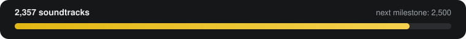

  

<h1 align="center">OSTDB</h1>

<b>The open database of official video game soundtracks.</b> Every game, its OST, and where to stream it: Spotify, Apple Music and album.link.

  <a href="https://ostdb.net"><b>Website</b></a> &middot;
  <a href="https://ostdb.net/api"><b>API</b></a> &middot;
  <a href="#-download-the-data"><b>Download the data</b></a> &middot;
  <a href="#-add-a-soundtrack-in-2-minutes"><b>Contribute</b></a> &middot;
  <a href="games/README.md"><b>Browse all games</b></a>

> [!TIP]
> **🎃 Hacktoberfest 2026:** adding a missing soundtrack is a perfect first pull request. Pick a game from **Most wanted** below, click **Add it**, fill in the links, and open the PR. Merged PRs count towards Hacktoberfest.

## 🔥 Most wanted

The most popular games that still have no soundtrack on OSTDB. Find the official OST, click **Add it**, and open a pull request.

More in **[missing/](missing/README.md)** (0 games).

## 🎵 Add a soundtrack in 2 minutes

No Git, no install: everything happens on GitHub in your browser.

1. Pick a game from **Most wanted** above (or any file in [missing/](missing/README.md)) and click **✏️ Add it**.
2. Paste the album's **Spotify**, **Apple Music** or **album.link** URL, the album name and its cover URL. Delete the `_readme` line.
3. Choose **Create a new branch and start a pull request**, then **Propose changes**.

A bot checks the album and posts both covers on your PR; once it's approved, the soundtrack appears on [ostdb.net](https://ostdb.net) within minutes. Rather use a form? [Submit on ostdb.net](https://ostdb.net/submit). Full guide: **[SUBMITTING.md](SUBMITTING.md)**.

## 📦 Download the data

| Format | Link |
|---|---|
| JSON | [all-games.json](all-games.json) (updated with every soundtrack) |
| CSV, one row per album | [ostdb.csv](https://github.com/OSTDB/soundtracks/releases/latest/download/ostdb.csv) |
| SQLite | [ostdb.sqlite](https://github.com/OSTDB/soundtracks/releases/latest/download/ostdb.sqlite) |
| REST API | [ostdb.net/api](https://ostdb.net/api) |

Weekly snapshots are on the **[Releases](https://github.com/OSTDB/soundtracks/releases)** page. Games without a soundtrack yet are in **[missing.json](missing.json)**.

## 📚 Browse

All 1,874 games with a soundtrack, by letter: **[games/](games/README.md)**.

## License & credit

The OSTDB data is licensed under **[CC BY-NC-SA 4.0](LICENSE)**: free for non-commercial use, credit required, share alike. Wherever you use it, credit it visibly with a link:

> Data from [OSTDB (ostdb.net)](https://ostdb.net)

Commercial use needs permission ([support@ostdb.net](mailto:support@ostdb.net)). Album art, game art and IGDB metadata are not covered and belong to their owners. OSTDB is a non-commercial fan project, not affiliated with Spotify, Apple, IGDB or any game company. Details in **[NOTICE.md](NOTICE.md)**.

---

Generated by <a href="https://github.com/OSTDB/soundtracks-sync">ostdbbot</a> &middot; 2,356 soundtracks &middot; last updated 2026-10-21T11:55:44.775Z
